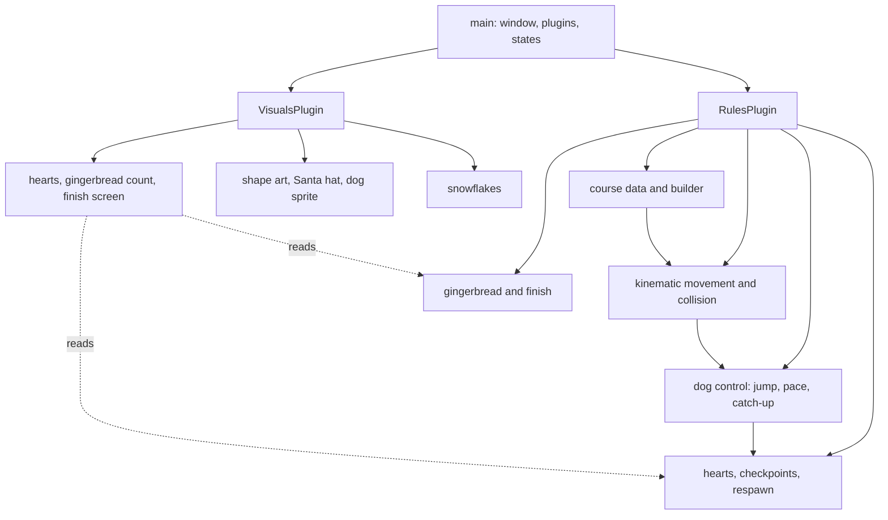
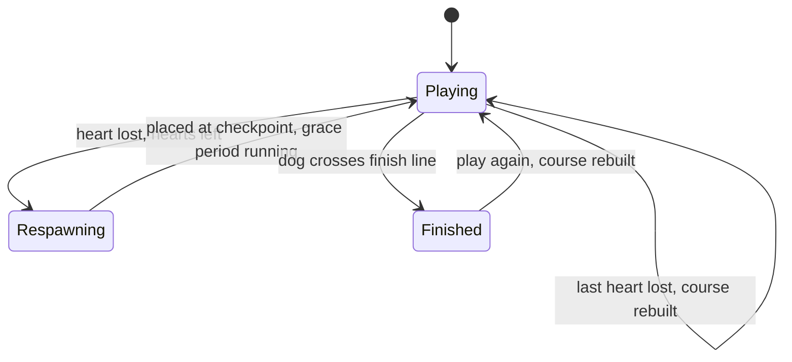

# Christmas Agility Level - Plan

## Goal Capsule

- **Objective:** By Christmas Eve (2026-12-24), the family's 14-year-old daughter can play through a cheerful Christmas agility course in which a miniature schnauzer in a Santa hat jumps hurdles and platforms and collects gingerbread cookies.
- **Means:** A hand-rolled kinematic platformer on Bevy 0.20, with game rules kept separate from shape-drawn presentation (KTD1, KTD2, KTD5).
- **Product authority:** The Product Contract below wins on behavior; the Planning Contract wins on mechanism within it. This plan covers only the first Christmas level. Multiple levels, difficulty progression and racing a personal best are not active scope.
- **Execution profile:** One branch, one pull request, units landed in order U1 → U6. Commits per unit are fine.
- **Stop conditions:** Stop and ask if a requirement turns out infeasible, or if by 2026-12-17 the work is behind and the cut order in Scope Boundaries must be applied.
- **Who finishes:** The implementing agent builds and verifies; the user plays the level and approves before merge.
- **Open blockers:** None.

---

## Product Contract

### Summary

Replace the current balloon level with one Christmas-themed agility course. The course scrolls by itself from right to left; the player adjusts the pace and jumps the dog over hurdles, onto agility tables and up an A-frame while collecting gingerbread. Three gentle hearts, checkpoints and a celebratory finish make it a feel-good game rather than a tense one.

### Problem Frame

The game started as a test drive of the Bevy engine: a dog floats on balloons, collects bones and gets knocked down by hawks, with no goal and no end. The idea behind it comes from the family's youngest, who as a child often played "aksaleiri" (agility camp), a camp where children train agility with their dogs. The family now wants the game to become something that delights them, starring a dog that looks like their own miniature schnauzer.

The main player is now 14, plays independently on the keyboard, loves animals and dislikes tension and violence. Christmas is about four weeks away, which makes a Christmas level the natural first step and sets a hard date.

### Key Decisions

- **Christmas agility course rather than a generic Christmas platformer.** Hurdles, agility tables and an A-frame carry the "aksaleiri" origin of the game; generic platforms would drop it. (session-settled: user-approved — chosen over a Christmas-village platformer of gift stacks and ice blocks: agility-style obstacles were part of the request and the game's origin.) Governs R3, R4, R5.
- **The course scrolls by itself; the player adjusts the pace but cannot stop it.** (session-settled: user-directed — chosen over full left/right player control, after first picking that option and then reversing: the user wants to keep the moving-course feel of the current game.) Governs R1, R2.
- **Gentle hearts instead of no failure or score-only.** (session-settled: user-directed — chosen over "no failure at all" and "hits only cost points": a little challenge without harsh punishment.) Governs R7, R8, R9, R10.
- **Getting caught by the screen edge costs a heart.** Low obstacles can block the dog, so a missed jump has a consequence. (session-settled: user-directed — chosen over designing the level so the dog can never get stuck, and over pausing the scroll while the dog is stuck.) Governs R8.
- **Hurdles block but do not hurt.** Touching a hurdle costs nothing by itself; only being carried off the left edge does. This keeps contact with agility equipment friendly. Governs R4, R8.
- **The Christmas level replaces the balloon level.** (session-settled: user-approved — chosen over a start menu offering both levels: less work before Christmas; the old level stays in git history.) Governs R17.
- **The dog is the existing schnauzer silhouette.** Recolored black or white to stand out against the chosen background. (session-settled: user-directed — the user offered the bundled silhouette instead of choosing between self-made art, Claude-drawn art or asset packs.) Governs R12.

### Requirements

**Course and movement**

- R1. The course scrolls continuously from right to left, so the dog appears to run to the right.
- R2. The arrow keys slow down or speed up the scroll within a fixed range; the slowest pace is calm enough that the player never feels rushed, and the scroll never stops.
- R3. The dog jumps with the Space key and lands on the ground or on any platform below it, so it can move between levels of different height.
- R4. Candy-cane hurdles stand on the course; the dog must jump over them, and running into one stops the dog's forward progress.
- R5. Agility tables (raised platforms) and an A-frame let the dog climb to higher levels; the dog can walk up the A-frame slope.
- R6. The course includes gaps between platforms (for example a frozen pond) and rolling snowballs that the dog must avoid.

**Hearts and checkpoints**

- R7. The dog has three hearts, shown on screen during play.
- R8. The dog loses one heart when it falls into a gap, touches a rolling snowball, or is carried off the left edge of the screen while blocked by an obstacle.
- R9. After losing a heart, the dog continues from the latest checkpoint it passed and keeps the gingerbread collected so far; checkpoints are spaced so that a lost heart costs only a short stretch of the course.
- R10. When the last heart is lost, the level restarts from the beginning with three hearts and zero gingerbread.

**Collecting and finish**

- R11. Gingerbread cookies are placed along the course, on and between platforms; the dog collects one by touching it, and the collected count is shown on screen.
- R12. The playable character is the miniature schnauzer silhouette from the repository, wearing a Santa hat.
- R13. The course ends at a Christmas-themed finish line; reaching it shows the number of gingerbread collected and a small celebration.
- R14. From the finish screen the player can play the level again.

**Look and feel**

- R15. The scene is wintry and festive: a winter background, snowy ground and Christmas-decorated obstacles, with nothing threatening or violent.
- R16. Snowflakes drift down from the sky during play.
- R17. The hawks, balloons and bones of the current game are removed; the game starts directly in the Christmas level.

### Acceptance Examples

- AE1. Falling into a gap
  - **Covers R8, R9.**
  - **Given** the dog has three hearts and has passed the second checkpoint.
  - **When** it misses a jump and falls into the frozen pond.
  - **Then** it has two hearts, reappears at the second checkpoint, and keeps the gingerbread already collected.
- AE2. Blocked by a hurdle
  - **Covers R4, R8.**
  - **Given** the dog runs into a hurdle without jumping.
  - **When** it stays blocked and the scrolling carries it to the left edge.
  - **Then** it loses one heart and continues from the latest checkpoint; the moment of contact with the hurdle alone costs nothing.
- AE3. Last heart lost
  - **Covers R10.**
  - **Given** the dog has one heart and 12 gingerbread.
  - **When** it touches a rolling snowball.
  - **Then** the level restarts from the beginning with three hearts and zero gingerbread.
- AE4. Reaching the finish
  - **Covers R13, R14.**
  - **Given** the dog reaches the finish line with 23 gingerbread.
  - **When** it crosses the line.
  - **Then** the game shows "23" gingerbread with a celebration and offers to play again.

### Success Criteria

- The level is playable from start to finish on the family computer by 2026-12-24.
- At normal pace a run through the level takes about 2–3 minutes, and the main player can finish it within a few attempts.
- The main player recognizes the dog as a schnauzer and finds the level cheerful rather than stressful.

### Scope Boundaries

**If time runs short, cut in this order**

- Snowflakes (R16) first, then rolling snowballs (R6 obstacles); the gaps stay.
- The A-frame slope may become stairs, keeping the climb (R5).
- The must-haves are the dog, the Santa hat, jumping onto platforms and collecting gingerbread.

**Deferred for later**

- Sound effects and Christmas music.
- Family members waiting at the finish to receive the gingerbread.
- A second, harder level after the finish.
- Racing against your own previous best.
- Other agility obstacles such as the tunnel, seesaw or weave poles.
- A start menu.

<!-- ce-section: work-relationships -->
### How This Work Fits Together

This plan covers only the first Christmas agility level. The breakdown below is the current understanding of the larger game, not a committed roadmap.

- A multi-level Agility Camp game with difficulty increasing level by level.
  - Depends on this level establishing the jumping, platform, heart and finish mechanics.
  - Still to decide: how levels are chosen or unlocked, and whether the balloon level returns as one of them.
- Racing against your own previous best.
  - Enables replay of any level; depends on the finish screen from R13.
- Sound and music.
  - Can proceed independently of this level.

### Dependencies / Assumptions

- Claude draws simple art for the Santa hat, gingerbread, obstacles, finish line and background (KTD5); the user may replace any of it later, for example with images made in GIMP.
- No hard performance target; the family computer is a recent Mac.

### Outstanding Questions

**Deferred to Implementation**

- Which background colour works best, and therefore whether the silhouette is drawn black or white (R12, R15; mechanism in KTD6).
- How the A-frame slope feels in play, and whether the stairs fallback is needed (R5).
- Exact speeds, jump height, checkpoint spacing and course length, tuned by play to meet the Success Criteria (starting values in Assumptions).

### Sources / Research

- `src/main.rs` — the current game: balloon dog, bones, hawks, cloud and score text, all in one file, ported to Bevy 0.20.
- `assets/sprites/standing-right.png` — the black miniature schnauzer silhouette to reuse as the character.
- `assets/sprites/` — existing art, mostly for the balloon level that this plan replaces.
- Bevy 0.20 ships `bevy_rapier2d` 0.37 and `avian2d` 0.8 compatible releases (both require `bevy ^0.20`); KTD1 records why neither is used.
- Bevy 0.20 example `examples/movement/physics_in_fixed_timestep.rs` (in the cargo registry copy of `bevy-0.20.1`) — reference for input handling and time steps if KTD3 needs revisiting.

Product Contract preservation: restructured, no scope change: Outstanding Questions renamed to "Deferred to Implementation"; the frame-rate question is resolved by KTD3 and removed; art and silhouette notes now cite KTD5 and KTD6.

---

## Planning Contract

### Key Technical Decisions

- KTD1. **Hand-rolled kinematic movement and collision, no physics library.** The course is axis-aligned rectangles plus one slope, and platformer feel (jump arc, landing, blocking) is easier to tune directly than through a rigid-body simulation and a character-controller layer. Both `avian2d` and `bevy_rapier2d` support Bevy 0.20, so this can be revisited if the course grows curved or moving physics objects.
- KTD2. **Game rules are separated from presentation.** Rules (scrolling, dog movement, collisions, hearts, checkpoints, collecting, finish) live in a plugin that needs no rendering or assets, so it can run inside a headless test `App`. Visuals attach to the same entities from a separate plugin. This is what makes U2–U5 testable without a window.
- KTD3. **Movement is time-based in `Update`, with the per-frame delta clamped.** Speeds are in pixels per second and scaled by frame time, which fixes the refresh-rate dependence of the current game. Clamping the delta (for example to 1/30 s) prevents tunnelling through thin hurdles after a stall. A fixed timestep with interpolation is not needed at these speeds.
- KTD4. **The dog runs at scroll speed and catches up after being held back.** The camera moves right at the current scroll speed (R1, R2). The dog's target is a fixed "home" position on screen; while behind it and not blocked, the dog runs slightly faster than the scroll until it is home again. Blocked by a hurdle or a taller platform side, its forward speed is zero and the screen edge approaches (R4, R8).
- KTD5. **Art is drawn with Bevy 2D shapes in code, except the dog.** Hurdles, tables, A-frame, ground, gaps, snowballs, gingerbread, Santa hat, finish tree, hearts and snowflakes are built from meshes and colors. The machine has no command-line raster tools besides GIMP, and shapes keep everything editable in one place. Each visual is isolated so it can later be swapped for an image.
- KTD6. **The dog uses the existing schnauzer silhouette, colored for contrast.** If the chosen background needs a light dog, a white copy of `assets/sprites/standing-right.png` is produced once (GIMP batch mode via `gimp-console` is available) and committed alongside it; a runtime recolor of the loaded image is the fallback. Governs R12 with the Product Contract's silhouette decision.
- KTD7. **The course is authored as data in Rust.** One list of segments (ground runs, gaps, hurdles, tables, A-frame, gingerbread rows, checkpoints, snowball triggers, finish) builds the level. No file format or parser is introduced. An automated layout check walks this data to prove every required jump is within the dog's reach.
- KTD8. **Forgiving controls and respawn.** A short grace window lets the dog jump just after running off an edge, a jump pressed just before landing still fires, and after a respawn the dog cannot lose a heart for about two seconds. These keep the feel friendly for the main player without changing any rule in R7–R10.
- KTD9. **Restarting the level rebuilds it.** On losing the last heart (R10) or choosing to play again (R14), all course entities are despawned and the course is rebuilt from KTD7 data, which resets gingerbread, snowballs, hearts and position in one path.

### High-Level Technical Design

Module layout. Rules modules form the headless-testable core (KTD2); presentation modules only read their state.

Game flow. A respawn is a short sub-state of play, not a separate screen.

### Assumptions

- Starting values for tuning: window 1280 × 800 as today; scroll 200 px/s normal within 120–300 px/s; jump high enough to clear a hurdle and reach a table one step up; course length about 30,000 px for roughly 2.5 minutes at normal pace; a checkpoint every 15–20 seconds of play.
- The family computer is the development Mac (Apple M3 Pro, macOS), so no performance work or packaging is planned.

---

## Implementation Units

### U1. Game skeleton: modules, states, scrolling and pace

**Goal:** Replace the balloon game with an empty, scrolling Christmas-level skeleton whose camera advances at a player-adjustable pace.

**Requirements:** R1, R2, R17. KTD2, KTD3.

**Dependencies:** None.

**Files:**
- Modify `src/main.rs` (app setup, window, states, plugin wiring only)
- Create `src/rules.rs` (rules plugin, game state, scroll speed resource)
- Create `src/visuals.rs` (presentation plugin, camera that follows the rules' scroll position, background color)
- Test in `src/rules.rs` (`#[cfg(test)]` module)

**Approach:**
1. Remove hawks, balloons, bones, cloud and the old score systems from `src/main.rs`; keep the window title "Agility Camp".
2. Add game states (Playing, Finished) and a respawn sub-state per the game flow diagram in High-Level Technical Design.
3. Add a scroll-speed resource changed by the arrow keys within its range, and a scroll-position resource (world x of the view) that advances by speed × clamped delta (KTD3). The view's left edge, used by R8, derives from it and the window width.
4. In the visuals plugin, copy the scroll position onto the camera each frame, so the rules never depend on the camera (KTD2).
5. Keep the Esc-to-quit system.

**Patterns to follow:** System registration style already in `src/main.rs` (`add_systems(Startup/Update, …)`).

**Test scenarios:**
- Holding the right arrow for one second raises scroll speed but never above the maximum.
- Holding the left arrow for a long time lowers speed to the minimum and never to zero.
- With speed 200 px/s and a 0.5 s update, the scroll position advances 100 px.
- A single 1 s frame stall advances the scroll position by the clamped delta, not by 1 s worth of distance.

Test seam: a headless `App` with `MinimalPlugins` and the rules plugin, with manually advanced time and injected key input. It catches rule and timing errors; it does not catch anything visual.

**Verification:** `cargo run` opens a window where the view scrolls steadily and arrows change its pace; no balloon-level objects appear.

### U2. Dog movement: gravity, jumping, landing, blocking and the A-frame

**Goal:** The dog runs, jumps with Space, lands on ground and platforms, is stopped by hurdle and platform sides, and walks up the A-frame slope.

**Requirements:** R3, R4, R5. KTD1, KTD3, KTD4, KTD8.

**Dependencies:** U1.

**Files:**
- Create `src/physics.rs` (collider shapes, kinematic body, collision resolution as pure functions)
- Create `src/player.rs` (dog entity, input, catch-up, jump grace and buffer)
- Test in `src/physics.rs` and `src/player.rs` (`#[cfg(test)]` modules)

**Approach:**
1. Resolve movement per axis against solid rectangles: horizontal first (blocking), then vertical (landing, head bump). The dog's collider is a named body/feet box smaller than the sprite, reused by the U3 layout check.
2. Treat the A-frame as a ramp whose surface height is a function of x, so the dog follows it while grounded.
3. Apply KTD4's catch-up speed and KTD8's grace window and jump buffer in the player module.

**Technical design (directional):** each frame, desired velocity = scroll speed + catch-up (x) and gravity/jump (y); move along x and clip at the first solid side; move along y and snap to the first surface below; grounded = touching a surface or ramp.

**Test scenarios:**
- Dog standing on ground presses Space: it rises, peaks, and lands back on the ground.
- Dog jumps toward a table one step higher: it lands on the table top.
- Dog runs into a hurdle without jumping: its horizontal position stops at the hurdle's left side while the camera keeps moving.
- Dog jumps over a hurdle at normal pace: it clears it without touching.
- Dog walks onto the A-frame: its height follows the slope and it stays grounded at the top.
- Dog runs off a platform edge and presses Space within the grace window: the jump fires.
- Dog presses Space just before landing: the jump fires on landing.
- Dog held 300 px behind home and then unblocked: it moves toward home faster than the scroll and stops catching up at home.
- A clamped long frame does not let the dog pass through a hurdle.

**Verification:** In a temporary test layout the dog can be steered over hurdles, onto tables and up the A-frame; all scenarios pass.

### U3. Christmas course layout and layout check

**Goal:** The full Christmas course exists as data and is built into colliders, with an automated check that it is completable.

**Requirements:** R4, R5, R6, R9, R11, R13. KTD7, KTD9.

**Dependencies:** U2.

**Files:**
- Create `src/course.rs` (segment data, builder that spawns rule entities, rebuild helper)
- Test in `src/course.rs` (`#[cfg(test)]` module)

**Approach:**
1. Describe the course as an ordered segment list per KTD7, opening with an easy stretch and adding hurdles, tables, gaps, the A-frame and snowball triggers gradually.
2. Place checkpoints on safe ground only, spaced per Assumptions.
3. Place gingerbread on and between platforms; put the finish line at the end.
4. Provide one build-and-rebuild entry point used at start, after the last heart (R10) and for play again (R14), per KTD9.

**Test scenarios:**
- Every gap is wider than the dog's foot collider, so the dog can actually fall in (AE1), and no wider than its horizontal jump reach at minimum scroll speed plus the collider width, minus a safety margin. The dog's collider width is a named constant from U2, not the sprite bounds.
- Every platform step up is lower than the dog's jump height.
- Every checkpoint sits on solid ground, not above a gap or inside an obstacle.
- No gingerbread is placed inside a solid object or out of jump reach.
- The finish line is after the last obstacle, and the course length at normal pace falls in the 2–3 minute range.
- Rebuilding the course yields the same entity counts as the first build.

**Verification:** Layout tests pass; running the game shows the whole course scrolling past with colliders in place (temporary debug outlines are acceptable at this stage).

### U4. Hearts, hazards, checkpoints and restart

**Goal:** The dog loses hearts from gaps, snowballs and the screen edge, respawns at checkpoints, and the level restarts after the last heart.

**Requirements:** R6, R7, R8, R9, R10. KTD4, KTD8, KTD9. Covers AE1, AE2, AE3.

**Dependencies:** U3.

**Files:**
- Create `src/hazards.rs` (hearts resource, checkpoint tracking, snowballs, gap and edge detection, respawn, grace period)
- Test in `src/hazards.rs` (`#[cfg(test)]` module)

**Approach:**
1. Snowballs roll left along the ground once their trigger enters the view.
2. A fall below the course floor counts as falling into a gap; the left screen edge test applies only while the dog is blocked (R8).
3. Respawn places the dog on its latest checkpoint with the camera so the dog is at home, clears nearby snowballs, and starts the KTD8 grace period.
4. The last heart triggers the KTD9 rebuild with three hearts and zero gingerbread.

**Test scenarios:**
- Covers AE1. Dog with three hearts past checkpoint two falls into a gap: two hearts, placed at checkpoint two, gingerbread unchanged.
- Covers AE2. Dog blocked by a hurdle until the left edge reaches it: one heart lost, respawn at the latest checkpoint.
- Touching a hurdle and then jumping over it before the edge arrives costs no heart.
- Dog touches a rolling snowball: one heart lost.
- Dog touches a snowball during the grace period after respawn: no heart lost.
- Covers AE3. Dog with one heart and 12 gingerbread touches a snowball: course rebuilt, three hearts, zero gingerbread, dog at the start.
- Dog that has passed no checkpoint loses a heart: it respawns at the start.

**Verification:** Scenarios pass; in play, falling, being caught by the edge and hitting snowballs each cost exactly one heart.

### U5. Gingerbread, finish line and play again

**Goal:** The dog collects gingerbread with a visible count, and crossing the finish line shows the count with a celebration and a way to play again.

**Requirements:** R11, R13, R14. KTD9. Covers AE4.

**Dependencies:** U4.

**Files:**
- Create `src/collect.rs` (gingerbread pickup, count resource, finish detection)
- Create `src/hud.rs` (hearts and count display, finish screen with play-again prompt)
- Test in `src/collect.rs` (`#[cfg(test)]` module)

**Approach:**
1. Overlapping a gingerbread removes it and increments the count once.
2. Crossing the finish line enters the Finished state, which stops scrolling and gameplay input (jump and pace keys) and clears any buffered jump.
3. The finish screen shows "the dog brought N gingerbread" style text with a celebration effect. After the celebration has been visible for about one second, Space or Enter plays again through the KTD9 rebuild, so a jump pressed while crossing the line cannot skip it (R13).
4. Reuse the existing font `assets/fonts/FiraSans-Bold.ttf`.

**Patterns to follow:** The `Text` + `TextFont` + `Node` HUD pattern in the current `spawn_points` system in `src/main.rs`.

**Test scenarios:**
- Dog overlaps one gingerbread: count goes from 0 to 1 and that gingerbread is gone.
- Dog overlaps the same spot again: count does not increase.
- Covers AE4. Dog with 23 gingerbread crosses the finish line: state is Finished, scrolling stops, displayed count is 23.
- In Finished, pressing play again after the celebration delay: state is Playing, count is 0, hearts are 3, dog is at the start.
- Space pressed on the frame the dog crosses the finish line, or within the celebration delay: state stays Finished.
- Losing a heart after collecting gingerbread keeps the count (R9).

**Verification:** Scenarios pass; a full playthrough ends at the finish screen and the level can be replayed.

### U6. Christmas look: dog with Santa hat, festive course and snowflakes

**Goal:** The level looks wintry and cheerful, with the schnauzer silhouette in a Santa hat, decorated obstacles and drifting snow.

**Requirements:** R12, R15, R16. KTD5, KTD6.

**Dependencies:** U5.

**Files:**
- Modify `src/visuals.rs` (background, ground, obstacle and gingerbread shapes attached to rule entities)
- Create `src/art.rs` (shape builders: Santa hat, candy-cane hurdle, agility table, A-frame, gingerbread, snowball, finish tree, heart)
- Create `src/snow.rs` (snowflake spawning and drift)
- Possibly add `assets/sprites/standing-right-white.png` (per KTD6)

**Approach:**
1. Choose a background (for example an evening-blue sky) and decide the dog color per KTD6.
2. Attach shape visuals to each rule entity type and the Santa hat as a child of the dog sprite.
3. Add snowflakes as many small drifting shapes, independent of the rules, so they can be dropped first under the cut order.
4. Ensure nothing reads as threatening (no sharp hazards or dark imagery).

**Test expectation:** none -- presentation only; behavior is covered by U1–U5 tests, and look is verified by play.

**Verification:** The user runs the game and recognizes a schnauzer in a Santa hat on a festive agility course with falling snow.

---

## Verification Contract

| Check | Command or action | Applies to |
|---|---|---|
| Builds without errors | `cargo build` | every unit |
| Rules and layout tests pass | `cargo test` | U1–U5 |
| No new warnings in game code | `cargo build` output reviewed (pre-existing unused-code warnings removed with the old level) | every unit |
| Plays end to end | `cargo run`, play the full level once at normal pace and once at slowest pace | U4–U6 |
| Family check | The user plays the level and approves before merge | final |

---

## Definition of Done

- All units U1–U6 are implemented, or the Scope Boundaries cut order was applied and the dropped items are named in the PR description.
- `cargo build` and `cargo test` succeed, and every AE1–AE4 scenario not dropped by the cut order has a passing test. Cutting rolling snowballs drops AE3's snowball trigger, the snowball part of R8 and the U4 snowball scenarios; AE3's last-heart restart is then tested with a gap instead.
- A full playthrough reaches the finish screen in about 2–3 minutes at normal pace.
- No balloon-level code remains, and no abandoned experiments or temporary debug outlines are left in the diff.
- The user has played the level and approved it, before 2026-12-24.

---

## Deferred / Open Questions

These are review items left for the author. They do not block implementation.

### From 2026-11-25 review

- **The player gets no visible cue when a heart is lost or the level restarts** — U4 Hearts, hazards and restart; U6 Christmas look (P2, design-lens, confidence 75)

  After a fall, a snowball hit or being caught by the screen edge, the dog is silently moved back to a checkpoint, and after the last heart the whole level resets with no message. For a player who dislikes tension, this can feel confusing or like a crash.
  Change: show lost hearts as empty outlines with a short, gentle cue; make the dog blink during the after-respawn grace period; show a brief "Let's try again" message before a full restart resumes.

- **Checkpoints are invisible, so the player cannot tell how much a mistake will cost** — U3 Christmas course layout; U6 Christmas look (P3, design-lens, confidence 75)

  Continuing from the latest checkpoint only reassures the player if she can see where checkpoints are and when one has been passed.
  Change: add a festive checkpoint marker, such as a small decorated tree or flag, that changes appearance when the dog passes it.

- **The course starts scrolling immediately, before the player knows the controls** — U1 Game skeleton; U5 Finish and play again (P2, design-lens, confidence 75)

  With no start menu, scrolling begins as soon as the window opens and after every restart, so the first hurdles arrive while the player is still discovering that Space jumps and the arrows change pace.
  Change: at the start of every run, hold the scroll for about two seconds with a small "Space: jump, arrows: pace" hint, then start at the slowest pace.
