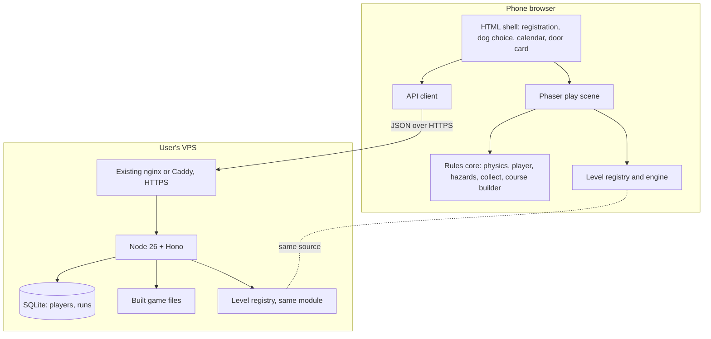
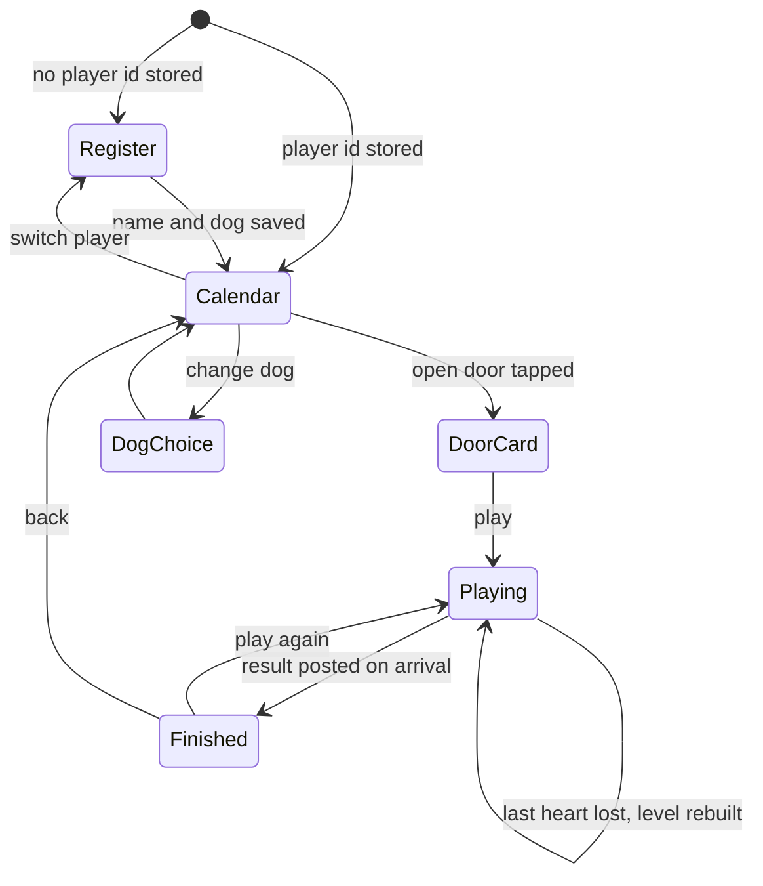

# Advent Calendar Browser Game - Plan

## Goal Capsule

- **Objective:** From 1 December 2026 the family plays Agility Camp on their phones as an Advent calendar. Each December day opens a new agility level, everyone plays as themselves with their chosen dog, and a leaderboard on every level shows who did best.
- **Means:** A TypeScript + Phaser browser game with plain HTML/CSS menus, served together with a small TypeScript server and SQLite database from the user's own VPS, built in this repository and ported from the existing Rust/Bevy Christmas level.
- **Product authority:** The Product Contract below wins on behavior; the Planning Contract wins on mechanism within it. This plan covers V1 (calendar, registration, door 1, results and leaderboards) by 2026-12-01, plus the level engine and doors 2–7 by their dates. Doors 8–24 and the obstacles they introduce are not active scope.
- **Execution profile:** Four pull requests. PR1 (U1–U6) is live by 2026-12-01, PR2 (U7) by 2026-12-02 and PR3 (U9) by 2026-12-04, each deployed before the door it serves opens. PR4 (U8, Rust removal) follows whenever the user has approved pushing the tag. Commits per unit are fine.
- **Stop conditions:** Stop and ask if a requirement turns out infeasible, if PR1 cannot be live on the VPS by the evening of 2026-11-30, or before pushing the `v0.1-bevy` tag (R28).
- **Who finishes:** The implementing agent builds and verifies locally; the user deploys to the VPS (the agent has no access to it), plays on their phone and approves each PR before merge.
- **Open blockers:** None. The VPS domain and HTTPS are an assumption (see Dependencies / Assumptions).

---

## Product Contract

### Summary

Agility Camp becomes a mobile-first browser game shaped as an Advent calendar with 24 doors. A player types their name once, picks Elmo, Laku or Alma, and plays the door of the day with one-tap controls; each finished run scores gingerbread plus a heart bonus, and every level has a family leaderboard. Door 1 is the existing Christmas level ported to the browser, and from door 2 onward levels are assembled from hand-designed course pieces by a daily recipe that makes each day harder than the last.

### Problem Frame

Agility Camp started as a Rust/Bevy test drive and now has one finished Christmas level, playable only on the development Mac by one person. The main player, the family's 14-year-old daughter, found that level extremely easy; that is fine only if harder levels follow. The family wants a reason to come back every day until Christmas and to compare results with each other, and everyone has a phone while only one person can use the Mac.

The first level's plan, `docs/plans/2026-11-25-2253-feat-christmas-agility-level-plan.md`, deferred multiple levels and difficulty progression; this plan picks them up. December starts in five days, so the first release date is fixed and the remaining levels arrive while the calendar is already running.

### Key Decisions

- **An Advent calendar of 24 levels, one per December day.** (session-settled: user-directed — chosen over 3 or 5 levels in total: the user wants a daily level, with the day shown in the level's name and graphics.) Governs R9, R10, R11.
- **Doors open by date.** (session-settled: user-approved — chosen over unlocking by completing the previous level, and over all doors open at once: it behaves like a real Advent calendar.) Governs R10.
- **Levels are released during December, not all before it.** (session-settled: user-approved — chosen over shipping all 24 levels by 1 December: five days is too short, and weekly batches leave room to tune difficulty.) Governs R12.
- **A mobile-first browser game, not a native app or a Bevy WebAssembly build.** (session-settled: user-approved — chosen over keeping Rust/Bevy compiled to WebAssembly: mobile text input, HTML menus, load size and iteration speed favour TypeScript.) Governs R1, R2, R3.
- **Results live on the user's own VPS in SQLite, with no third-party backend.** (session-settled: user-directed — chosen over Supabase.) Governs R4, R19.
- **Players identify by name only, with no password.** (session-settled: user-approved — chosen over accounts with passwords: a family game; a name typed again continues that player's results.) Governs R5, R6, R7.
- **One-tap controls, no pace control, and the dog crawls through tunnels by itself.** (session-settled: user-approved — chosen over the Rust version's arrow-key pace control and the brainstorm's earlier "down arrow to duck" tunnel: one tap fits phones.) Each level sets its own fixed speed. Governs R14, R24.
- **Score is gingerbread × 10 plus hearts left at the finish × 50.** (session-settled: user-approved — chosen over gingerbread only, and over adding a time bonus: rewards both collecting and a clean run.) Governs R18.
- **Levels are assembled from hand-designed pieces by a daily recipe.** (session-settled: user-approved — chosen over writing each level by hand and over generating levels from a difficulty number: keeps new-obstacle introductions and the difficulty curve under control while a week's batch stays quick to make.) Governs R21, R22, R25.
- **Gift-box stacks form an optional upper route that stays within one screen height.** (session-settled: user-approved — chosen over mandatory climbing with a vertically following camera, and over mandatory climbing within one screen.) Governs R23.
- **Every level is Christmas-themed, with the mood changing week by week and a festive finale on 24 December.** (session-settled: user-approved — chosen over one look for all levels, and over a separate background surprise for every day.) Governs R27.
- **Door unlocks follow the server's clock in Finnish time.** Everyone sees the same calendar, and moving a phone's clock does not open doors early. Governs R10.
- **Levels play in landscape; menus work in portrait.** The course is a wide side view; in portrait during play the game asks the player to turn the phone. Governs R1.
- **Same repository, with the Bevy version kept under a tag.** (session-settled: user-approved — chosen over a new repository: keeps the plans, CE config, remote and history, and the Rust code stays as porting reference.) Governs R28, R29.

### Requirements

**Platform and access**

- R1. The game is playable in a phone browser by touch and fills the screen in landscape during play; menus also work in portrait.
- R2. The game is playable in a desktop browser with the keyboard, where Space is the tap.
- R3. The game can be added to a phone's home screen and then opens full screen like an app.
- R4. One server on the user's VPS serves the game and stores players and results.

**Players and dogs**

- R5. On first visit the player types their own name, with no password, and picks a dog from Elmo, Laku and Alma shown side by side.
- R6. A name that matches an existing player, ignoring letter case and surrounding spaces, continues as that player with their results.
- R7. The device remembers its player, so the name is not asked again; from the calendar the player can switch to a different name or change dog at any time.
- R8. Elmo and Laku are both black miniature schnauzers drawn from the existing silhouette and told apart by a small accessory; Alma is the same silhouette in white. The chosen dog is the one that runs.

**Advent calendar**

- R9. The calendar is the game's main view, with 24 doors numbered by December day.
- R10. Door N opens on N December, Finnish time by the server's clock; before 1 December every door is closed, and from 25 December every door is open.
- R11. Opening an open door shows the level's name with its day number, the level's leaderboard and a play button; any open door can be played again at any time.
- R12. A door whose date has come but whose level has not been released yet shows as "coming soon" and cannot be played.
- R13. Each door shows whether the current player has finished that level and their best score on it.

**Playing a level**

- R14. A tap anywhere on the play area, or Space, makes the dog jump; there is no other control during play.
- R15. Each level scrolls by itself at its own fixed speed and keeps the first level's rules: three hearts, a heart lost for falling into a gap, touching a rolling snowball or being carried off the left edge while blocked, a restart from the latest checkpoint after a lost heart, and a full level restart with three hearts and zero gingerbread after the last one.
- R16. Door 1 is the existing Christmas level ported to the browser with the same course, obstacles, jump physics and rules, running at a fixed speed equal to the Rust version's normal pace.
- R17. The finish screen shows gingerbread collected, hearts left and the score, and offers to play again or go back to the calendar.

**Scores and leaderboards**

- R18. A finished run scores 10 points per gingerbread plus 50 points per heart left at the finish; a run that does not reach the finish scores nothing.
- R19. Every finished run is saved for its player, and each level's leaderboard lists every player's best score on it, highest first.
- R20. A test mode, reachable only by the developer and not from the game's menus, opens every door, including released levels whose date has not come; runs in test mode are not saved.

**Levels 2–7 and the level engine**

- R21. From door 2 on, each level is assembled from hand-designed course pieces by that day's recipe, which sets the speed, gap widths, table heights, obstacle density, snowball count and which pieces may appear.
- R22. Difficulty rises from day to day through faster speed, wider gaps, higher tables, denser obstacles and more snowballs, so door 7 is clearly harder than door 1.
- R23. Gift-box stacks offer an optional upper route with more gingerbread; the lower route is always passable, and both stay within one screen height.
- R24. A Christmas tunnel stands on the course; the dog runs through it on its own while on the ground.
- R25. A new obstacle type first appears in a short, easy stretch before it is mixed with others.
- R26. Every level is proven completable by automated layout checks at that level's speed, as the first level's checks do today.
- R27. Every level is Christmas-themed, shows its day number on the course, and takes about 2–3 minutes to run.

**Repository and the Bevy version**

- R28. The Rust/Bevy version is preserved under the git tag `v0.1-bevy` on main commit `6d41cb1` before any Rust code is removed; pushing that tag waits for the user's explicit go-ahead.
- R29. The browser game and server live in this repository; the Rust sources stay as porting reference until the port of door 1 is complete, then are removed in a separate commit.

### Key Flows

- F1. First visit
  - **Trigger:** A family member opens the game link on their phone for the first time.
  - **Steps:** They type their name and pick a dog; the calendar appears with today's door highlighted; they open it, see the leaderboard and tap play; after the finish screen they return to the calendar, where the door now shows their best score.
  - **Covered by:** R5, R7, R9, R11, R13, R17, R19
- F2. A returning player on another device
  - **Trigger:** A player who registered on their phone opens the game on the family laptop.
  - **Steps:** They type the same name, in any letter case; the game continues as that player, with their best scores on the doors; they may change dog before playing.
  - **Covered by:** R6, R7, R13

### Acceptance Examples

- AE1. Doors open by the server's date
  - **Covers R10, R12.**
  - **Given** it is 3 December in Finland and door 3's level has been released.
  - **When** a player whose phone clock says 10 December opens the calendar.
  - **Then** doors 1–3 can be played and doors 4–24 are closed.
- AE2. A released level is late
  - **Covers R12.**
  - **Given** it is 5 December and only doors 1–4 have been released.
  - **When** a player looks at door 5.
  - **Then** it shows "coming soon" and cannot be played.
- AE3. The same name on another device
  - **Covers R6.**
  - **Given** Marjaana registered on her phone and has a best score of 330 on door 1.
  - **When** she types "marjaana" on the laptop.
  - **Then** she continues as Marjaana and door 1 shows 330.
- AE4. Scoring a finished run
  - **Covers R17, R18.**
  - **Given** the dog reaches the finish with 23 gingerbread and 2 hearts left.
  - **When** the finish screen appears.
  - **Then** it shows 23 gingerbread, 2 hearts and a score of 330.
- AE5. The leaderboard keeps a player's best
  - **Covers R19.**
  - **Given** Eveliina has finished door 1 three times with 250, 330 and 280.
  - **When** anyone opens door 1.
  - **Then** the leaderboard lists Eveliina once, with 330.
- AE6. The upper route is optional
  - **Covers R23, R26.**
  - **Given** a level with a gift-box upper route.
  - **When** the dog never climbs it.
  - **Then** the lower route still leads to the finish, and the level's checks pass for both routes.
- AE7. Test mode
  - **Covers R20.**
  - **Given** it is 2 December and door 5 has been released.
  - **When** the developer opens the game in test mode and finishes door 5.
  - **Then** door 5 could be played and no result was saved.

### Success Criteria

- On 1 December 2026 every family member can open the game on their own phone, register and play door 1, and their scores appear on its leaderboard.
- Doors 2–7 are each playable on their own date.
- The main player finds door 7 a real challenge compared with door 1, yet finishes it within a few evenings' attempts.
- Play feels smooth on the family's phones, with no missed taps.

### Scope Boundaries

**Deferred for later**

- Doors 8–24, built with the same engine in weekly batches: introducing the dog walk, seesaw, tyre (hoop) and weave poles, the weekly mood changes and the 24 December finale. If those batches run late, cut weekly mood changes first, then the seesaw, then the tyre.
- Sound effects and music.
- Passwords, accounts or protection against someone playing under another person's name.
- Offline play.
- Deleting or renaming players, and moderating names.
- Separate leaderboards per dog.

**Outside this product's identity**

- A native app or app-store release.
- Third-party backends such as Supabase or Firebase.
- Further development of the Rust/Bevy version.

<!-- ce-section: work-relationships -->
### How This Work Fits Together

This plan covers V1 and doors 2–7. The breakdown below is the current understanding of the rest of December, not a committed roadmap.

- Doors 8–24 in weekly batches.
  - Depends on the level engine and course pieces from this plan (R21–R26).
  - Still to decide: which day introduces each new obstacle, and the mood of each week.
- Removing the Rust sources.
  - Depends on door 1's port being complete (R29) and the tag existing (R28).
- Sound and music.
  - Can proceed independently of the level work.

### Dependencies / Assumptions

- The user's VPS has, or can get, a domain name and an HTTPS certificate (for example Let's Encrypt); home-screen install needs HTTPS.
- The VPS can run a Node.js server and keep a SQLite file on disk.
- The family's phones run current iOS or Android browsers.
- The existing level's rules, course data, physics values and layout checks in `src/course.rs`, `src/physics.rs`, `src/player.rs`, `src/hazards.rs` and `src/collect.rs` are the source for door 1 and for the engine's feasibility checks.

### Outstanding Questions

**Deferred to Implementation**

- Exact speed, gap and table values per day for doors 2–7, tuned by play within the starting values in Assumptions and the R26 checks (R22).
- Whether `node:sqlite` behaves well on the VPS's Node build; `better-sqlite3` is the fallback (KTD6).

### Sources / Research

- `docs/plans/2026-11-25-2253-feat-christmas-agility-level-plan.md` — the first level's requirements, rules and tuning values that door 1 preserves.
- `src/course.rs` — the course `Builder` and the layout tests (gaps, hurdles, steps, checkpoints, cookies, run length) that R26 extends to every level.
- `src/rules.rs` — scroll speeds: 140 minimum, 200 normal, 300 maximum px/s; window 1280 × 800.
- `src/player.rs` — gravity 1800, jump velocity 800, dog collider 60 × 68, coyote time 0.1 s, jump buffer 0.12 s.
- `src/hazards.rs` — three hearts, 2 s respawn grace, snowball size and speed.
- `assets/sprites/standing-right.png` — the black schnauzer silhouette for all three dogs.
- Phaser releases, https://github.com/phaserjs/phaser/releases — 4.2.1 is the current stable line; 3.90.0 was the last Phaser 3 release.
- Node.js TypeScript and SQLite docs, https://nodejs.org/api/typescript.html and https://nodejs.org/api/sqlite.html — type stripping is stable in Node 26 LTS; `node:sqlite` is a release candidate that needs no flag.
- Chrome install criteria, https://developer.chrome.com/blog/update-install-criteria — a service worker is not required to install; HTTPS, a manifest and 192/512 px icons are.
- WebKit bug 257695 — iPhone Safari cannot lock screen orientation from a web page.

Product Contract preservation: restructured, no scope change: Outstanding Questions resolved by KTD4 (player memory and test mode), Assumptions (introduction days), KTD10 (Elmo and Laku accessories), KTD12 (deployment) and KTD11 (landscape); remaining tuning items moved to "Deferred to Implementation".

---

## Planning Contract

### Key Technical Decisions

- KTD1. **Port the Rust rules as a pure TypeScript core; Phaser only draws and reads input.** Movement, collision, scrolling, hearts, checkpoints, cookies and course building live in plain TypeScript modules with no Phaser import, mirroring the Rust split between rules and presentation. They keep the hand-rolled kinematic physics (axis-separated AABB plus ramps, clamped frame delta, coyote time and jump buffer) and its exact constants, so door 1 feels the same and the Rust tests port almost one to one. Phaser's Arcade Physics is not used. Governs R15, R16, R26.
- KTD2. **Stack: Phaser 4.2, Vite 8, Vitest 5, TypeScript, plain HTML/CSS menus.** Phaser 4 is the current stable line. Vitest's default Node environment runs the rules core without a browser. Menus, registration and the calendar are DOM, because mobile text input and scrolling lists are easier in HTML than in a canvas. Governs R1, R5, R9.
- KTD3. **Server: Node 26 LTS running TypeScript directly, Hono, SQLite.** Node's stable type stripping removes the server build step. The server code uses erasable syntax only (no enums or parameter properties) and `.ts` import extensions. Hono with `@hono/node-server` serves the JSON API and the built static game in about a hundred lines. Governs R4.
- KTD4. **Players are found by a normalized name key; the device stores the player id.** Registration upserts on the name trimmed and lower-cased, so the same name on another device continues that player (R6). The browser keeps the returned player id in `localStorage`; there is no session or password (product decision on name-only identity). Test mode is a secret key: the server reads it from an environment variable, and a page opened with that key in the URL gets every released door opened and never posts results (R20).
- KTD5. **The server owns the date and the score.** It computes "today" in `Europe/Helsinki` for every calendar request and rejects a result for a door that is not open yet. It recomputes the score from gingerbread and hearts per R18 and checks them against the level's cookie count and the three-heart cap. No other anti-cheat. The season is the year of the most recent 1 December on or before today, so January to November still belong to the previous December and its doors stay open per R10 until the next season starts; before the first season (1 December 2026) every door is closed. Governs R10, R18, R19.
- KTD6. **SQLite through `node:sqlite`, with results keyed by season.** The built-in module needs no native build on the VPS; it is a release candidate, so a thin data module keeps a swap to `better-sqlite3` to one file. Every run stores its season (per KTD5), so next year's calendar starts empty without a migration. Tables: players (id, name, name key, dog, created) and runs (id, player, season, day, gingerbread, hearts, score, created).
- KTD7. **Levels are shared TypeScript data used by both client and server.** The level registry (day number to recipe or hand-built layout) is imported by the game and the server alike. A door is "released" when its level is in the deployed build's registry. The server uses the same registry to validate results and to report "coming soon" (R12).
- KTD8. **Level engine: a seeded recipe over a library of hand-designed pieces.** Each piece is a short builder routine on the ported `Builder` (for example "gap then hurdle", "table stairs", "gift-box climb with upper route", "snowball run-up", "tunnel"). A day's recipe sets speed, gap and table ranges, density, snowball count, the allowed pieces, the piece being introduced and a fixed seed. The engine opens with a warm-up, plays the introduced piece alone first (R25), then picks pieces with a seeded random generator until the 2–3 minute length is reached. The same day therefore always yields the same course, which keeps leaderboards fair and the tests stable. Governs R21, R22, R25.
- KTD9. **Feasibility checks run per level at that level's speed.** The Rust layout tests become one parameterized suite over every registered level. Each check uses the level's fixed speed in place of the old minimum pace, keeps the 20 px margin, and also checks the upper route and tunnel pieces. Governs R26.
- KTD10. **Dogs share one silhouette.** Alma's white version is generated once at load by drawing the black PNG through a white fill on a canvas, so no new art file is needed. Elmo wears a red scarf and Laku a green one, drawn as shapes like the Santa hat. Governs R8.
- KTD11. **Fixed 1280 × 800 game world, scaled to fit, with a rotate overlay.** Phaser's Scale Manager uses FIT with centring, so the course geometry and the tests keep their units. iPhone Safari cannot lock orientation, so in portrait during play a CSS overlay asks the player to turn the phone. The canvas uses `touch-action: none`, and any `pointerdown` on the play area counts as a jump. Governs R1, R14.
- KTD12. **Deploy behind the existing reverse proxy.** The Node server listens on localhost under a systemd unit, and the user's existing nginx or Caddy proxies a subdomain to it with HTTPS. A deploy script builds locally and copies the build and server code to the VPS with rsync over SSH, then restarts the service. Releasing a new level batch is a normal deploy (R12).
- KTD13. **Installability through a manifest and icons only.** A web app manifest with `display: standalone`, 192 and 512 px icons, an `apple-touch-icon` and the status-bar meta tag cover Android and iOS. No service worker is added, because offline play is out of scope. Governs R3.
- KTD14. **The browser game lives in `web/`; the Rust code stays until PR4.** The new project sits in its own directory next to the Rust sources, so `cargo` and `npm` do not collide. PR4 removes the Rust sources and the unused balloon-level sprites once the tag exists (R28, R29). The schnauzer PNG and the font are copied into `web/public/` in U1.
- KTD15. **Player-facing text is Finnish; code and docs are English.** The whole family plays, and the menus are new anyway.
- KTD16. **Released levels are frozen.** Once a door is live, its built course must not change, or leaderboard scores stop being comparable. A snapshot test records each released level's layout; changing the engine or pieces for later doors must leave those snapshots unchanged. Governs R19, R21.
- KTD17. **Player names are plain text.** The server accepts names of 1–20 characters after trimming, and the client renders every name with text nodes, never as HTML, because names are visible to every player on the leaderboards. Governs R5, R19.
- KTD18. **Fresh pages after every deploy.** The server sends `index.html` with `Cache-Control: no-cache` and the hashed build files as immutable, so a phone picks up new levels on its next visit. If the server reports a door open that the loaded page has no level for, the door card shows "coming soon" with a reload prompt. Governs R12.

### High-Level Technical Design

Components and data flow. The rules core and the level registry are shared and have no Phaser or DOM dependency (KTD1, KTD7).



App flow on the client. The HTML shell owns every screen except play; the Phaser scene runs only while a level is being played.



API surface (directional, final shapes decided in U4):

| Method and path | Purpose | Requirement |
|---|---|---|
| `POST /api/players` | Find or create a player by name, set dog; returns player id | R5, R6 |
| `PATCH /api/players/:id` | Change dog | R7 |
| `GET /api/calendar?player=…` | Today's date, door states (closed, open, coming soon) and the player's best per door | R10, R12, R13 |
| `GET /api/levels/:day/leaderboard` | Every player's best score on that door | R19 |
| `POST /api/runs` | Save a finished run; server recomputes the score | R18, R19 |

Level engine (directional):

```text
recipe(day) = { speed, gapRange, tableRange, density, snowballs, pieces[], introduces?, seed }
build(recipe):
  warm-up flat ground with cookies
  if introduces: easy solo version of that piece, then a checkpoint
  rng = seeded(recipe.seed)
  while course time at recipe.speed < target (about 150 s):
    piece = rng.pick(recipe.pieces), sized from the ranges and density
    every ~15-20 s of play: checkpoint on safe ground
  finish
```

### Output Structure

```text
web/
  package.json, tsconfig.json, vite.config.ts
  index.html                 HTML shell, manifest link, rotate overlay
  public/                    manifest, icons, standing-right.png, FiraSans-Bold.ttf
  shared/                    rules core and levels, used by client and server
    physics.ts, player.ts, hazards.ts, collect.ts, course.ts, constants.ts
    levels/registry.ts, levels/engine.ts, levels/pieces.ts, levels/recipes.ts
    score.ts, calendar.ts
    *.test.ts
  src/                       browser-only code
    main.ts, api.ts, ui/*.ts, ui/style.css
    game/PlayScene.ts, game/art.ts, game/hud.ts, game/snow.ts, game/dogs.ts
  server/
    main.ts, app.ts, db.ts, app.test.ts
  deploy/
    deploy.sh, agility-camp.service, nginx.conf.example, Caddyfile.example, README.md
```

### Assumptions

- Starting values for doors 2–7: speed rising from 210 to 260 px/s in steps of 10; the widest gap rising towards the reach limit at that speed minus the 20 px margin; the highest single step rising from 100 to about 135 px (the ported step check allows at most the 178 px jump height minus twice the 20 px margin, about 138 px); obstacles every 300–500 px at door 2 down to 200–350 px at door 7; one to four snowballs per checkpoint section.
- The gift-box upper route is a run of floating gift-box platforms with at least the dog's height plus 20 px of headroom above the ground route, reached by a stack low enough to jump onto. The ground route below has no solid boxes reaching the ground other than that entry stack, which a ground runner jumps like a hurdle.
- Gift-box stacks are introduced on door 3 and the tunnel on door 5. Doors 2 and 4 tighten the existing obstacles; doors 6 and 7 mix everything.
- The tunnel is a ground-level tube whose roof is a walkable platform. A grounded dog entering its mouth switches to a lower crawl collider and cannot jump until it leaves. A dog arriving in the air above the roof lands on it and misses the cookies inside; a dog in the air but below the roof meets the tunnel's front face and is blocked like a hurdle until it lands and crawls in.
- The user's Mac has Node 26 for development, and the VPS can install Node 26.
- There is no CI in this repository; checks run locally.

### Risks

- **Five-day runway before 2026-12-01.** Mitigation: PR1 ports door 1 first and keeps menus plain; the unit order puts a playable level on a phone as early as possible. If time runs out, the leaderboard view (part of U5) slips to the first days of December while results are already being saved.
- **Physics feel drifts in the port.** Mitigation: port the Rust physics tests unchanged in intent and compare a recorded jump arc against the Rust constants.
- **Touch latency or missed taps on phones.** Mitigation: `touch-action: none`, no double-tap zoom, jump buffer kept from the Rust version, a manual check on both an iPhone and an Android phone in U6.
- **`node:sqlite` is a release candidate.** Mitigation: all queries live in `web/server/db.ts`, so switching to `better-sqlite3` touches one file.

---

## Implementation Units

### PR1: V1 — calendar, registration, door 1 and leaderboards

Live on the VPS by 2026-12-01.

### U1. Bevy tag and web project scaffold

**Goal:** Preserve the Rust version under a tag and create the empty TypeScript project that builds, tests and serves a blank page.

**Requirements:** R28, R29. KTD2, KTD3, KTD14.

**Dependencies:** None.

**Files:**
- Create `web/package.json`, `web/tsconfig.json`, `web/vite.config.ts`, `web/index.html`, `web/src/main.ts`
- Create `web/public/` with copies of `assets/sprites/standing-right.png` and `assets/fonts/FiraSans-Bold.ttf`
- Modify `.gitignore` (add `web/node_modules`, `web/dist`, `web/data/`)
- Modify `README.md` (how to run the web game and where the Bevy version went)

**Approach:**
1. Create the local tag `v0.1-bevy` on `6d41cb1`. Do not push it; ask the user first (R28).
2. Scaffold with Vite, TypeScript and Phaser 4.2, and add Vitest in its default Node environment. Use `erasableSyntaxOnly` and `verbatimModuleSyntax` so the shared code also runs under Node's type stripping (KTD3).
3. Scripts: dev, build, test, and a server start that runs `server/main.ts` with Node directly.

**Test expectation:** none — scaffolding; U2 adds the first tests.

**Verification:** `npm run build` and `npm test` succeed in `web/`; `git tag -l v0.1-bevy` shows the tag on `6d41cb1`.

### U2. Rules core and door 1 ported to TypeScript

**Goal:** The first Christmas level's rules and course run headless in TypeScript with the same values and the same tests as the Rust version, at a fixed speed instead of player pace.

**Requirements:** R14, R15, R16, R26. KTD1, KTD9.

**Dependencies:** U1.

**Files:**
- Create `web/shared/constants.ts`, `web/shared/physics.ts`, `web/shared/player.ts`, `web/shared/hazards.ts`, `web/shared/collect.ts`, `web/shared/course.ts`, `web/shared/score.ts`
- Create `web/shared/levels/registry.ts` (door 1 only for now)
- Test `web/shared/physics.test.ts`, `web/shared/player.test.ts`, `web/shared/hazards.test.ts`, `web/shared/collect.test.ts`, `web/shared/course.test.ts`, `web/shared/score.test.ts`

**Approach:**
1. Port `src/physics.rs` (AABB, ramps, `step`), `src/player.rs` (gravity, jump, catch-up, coyote time, jump buffer), `src/hazards.rs`, `src/collect.rs` and `src/course.rs` (layout, `Builder`, `christmas()`) as plain functions over a single game-state object instead of ECS entities.
2. Replace the scroll-speed resource and the arrow-key control with the level's fixed speed (R14); door 1 uses the Rust normal pace, 200 px/s (R16).
3. Expose one `update(state, input, dt)` entry point with the clamped delta, plus a rebuild function for restart and play again.
4. Score per R18 in `score.ts`; the client and the server both use it.

**Patterns to follow:** The Rust test helpers `rules_app_with`, `run_for` and `press` in `src/rules.rs` become a tiny headless driver that advances the state by fixed steps and injects taps.

**Test scenarios:**
- A grounded dog that taps rises, peaks and lands back on the ground.
- A dog jumping towards a table one step up lands on its top.
- A dog that runs into a hurdle stops at its left side while the view keeps scrolling.
- A dog walking onto the A-frame follows its slope and stays grounded.
- A tap just after running off an edge still jumps (coyote time), and a tap just before landing jumps on landing (buffer).
- A single 1 s frame stall moves things only by the clamped delta, and the dog does not pass through a hurdle.
- A dog with three hearts past checkpoint two falls into a gap: two hearts, back at checkpoint two, cookies kept.
- A dog blocked by a hurdle until the left edge reaches it loses one heart; touching a hurdle and then clearing it costs nothing.
- Touching a rolling snowball costs a heart, except during the 2 s grace after a respawn.
- With one heart left, a snowball hit rebuilds the level with three hearts and zero cookies.
- Running into a cookie collects it once.
- Covers AE4. 23 cookies and 2 hearts at the finish score 330.
- Door 1's layout checks pass at 200 px/s: gaps can be fallen into and jumped, hurdles cleared, steps lower than a jump, checkpoints on solid ground, cookies reachable, run length 2–3 minutes, and a rebuild gives the same course.

Test seam: pure functions under Vitest in Node. It catches rule, timing and layout errors; it does not catch drawing or touch problems.

**Verification:** All ported tests pass; the door 1 layout produces the same counts of hurdles, tables, gaps, cookies and checkpoints as `CourseLayout::christmas()`.

### U3. Phaser play scene

**Goal:** Door 1 is playable in a browser on desktop and phone with one-tap controls, the Christmas look and the finish screen with score.

**Requirements:** R1, R2, R8, R14, R16, R17, R27. KTD1, KTD10, KTD11, KTD15.

**Dependencies:** U2.

**Files:**
- Create `web/src/game/PlayScene.ts`, `web/src/game/art.ts`, `web/src/game/dogs.ts`, `web/src/game/hud.ts`, `web/src/game/snow.ts`
- Create `web/src/game/startGame.ts` (creates the Phaser game for a given door and dog, reports the finished run)
- Test `web/src/game/dogs.test.ts`

**Approach:**
1. The scene calls the core's `update` each frame and draws from its state: camera x from the scroll position, shapes for ground, hurdles, tables, A-frame, gaps, snowballs, cookies, checkpoints and finish tree, ported from `src/art.rs` and `src/visuals.rs`.
2. The dog is the silhouette with the Santa hat and slope tilt; `dogs.ts` builds the black and white textures and the red or green scarf (KTD10).
3. `pointerdown` anywhere and Space both feed the core's jump input; the HUD shows hearts, cookies and the day number (R27).
4. The finish screen shows cookies, hearts and score with confetti, then offers "Pelaa uudelleen" and "Takaisin kalenteriin" after the Rust version's short celebration delay.
5. Scale FIT at 1280 × 800 and the portrait rotate overlay per KTD11. While the overlay shows, the scene does not advance the run, so a player who taps play with the phone upright loses nothing before turning it.

**Patterns to follow:** `src/visuals.rs` (camera follow, dog tilt), `src/art.rs` (shape builders), `src/hud.rs` (finish screen and confetti), `src/snow.rs`.

**Test scenarios:**
- Each of Elmo, Laku and Alma maps to the expected base color and scarf.
- An unknown dog id falls back to Elmo.

Look and feel are verified by play, not by tests.

**Verification:** `npm run dev` on the Mac plays door 1 start to finish with Space; the same page on a phone in landscape plays with taps, shows the rotate overlay in portrait with the course standing still until the phone is turned, and the finish screen shows the score.

### U4. Server: players, calendar, results and leaderboards

**Goal:** A Node server stores players and finished runs in SQLite, answers the calendar and leaderboard requests, and serves the built game.

**Requirements:** R4, R5, R6, R7, R10, R12, R13, R18, R19, R20. KTD3, KTD4, KTD5, KTD6, KTD7.

**Dependencies:** U2 (shared score and level registry).

**Files:**
- Create `web/shared/calendar.ts` (door state for a date and a registry)
- Create `web/server/main.ts`, `web/server/app.ts`, `web/server/db.ts`
- Test `web/shared/calendar.test.ts`, `web/server/app.test.ts`

**Approach:**
1. `calendar.ts` turns a Helsinki date and the registry into door states: closed before 1 December and for days still ahead, open when the day has come and the level is registered, coming soon when the day has come but the level is not registered, every registered door open from 25 December until the next season starts (R10, R12, KTD5).
2. `POST /api/players` accepts names of 1–20 characters after trimming (KTD17).
3. `db.ts` creates the two tables per KTD6 on start-up and holds every query; the database file path comes from an environment variable.
4. `app.ts` builds the Hono app with the routes in the API table, served under `/api`, plus static files and an `index.html` fallback, with the cache headers of KTD18. It takes the clock and the test key as parameters, so tests can fix the date.
5. `POST /api/runs` rejects unknown players, doors that are not open, more cookies than the level holds, and hearts outside 1–3; it stores the server-computed score with the current season.
6. In test mode the calendar opens every registered door and `POST /api/runs` refuses to save (R20).

**Test scenarios:**
- Covers AE1. On 3 December with doors 1–3 registered, the calendar shows 1–3 open and 4–24 closed, whatever date the client sends.
- Covers AE2. On 5 December with doors 1–4 registered, door 5 is "coming soon".
- On 30 November 2026 every door is closed; on 26 December every registered door is open.
- On 2 January 2027 every registered door is still open, and a run posted then is stored in season 2026.
- An empty name, a name of only spaces, or a 21-character name is rejected.
- `index.html` is served with `no-cache` and a hashed build file as immutable.
- Covers AE3. Registering "Marjaana" and later " marjaana " returns the same player id.
- Changing dog keeps the player id and best scores.
- Covers AE5. Runs of 250, 330 and 280 for one player list that player once with 330 on the leaderboard.
- Two players with different bests are ordered highest first.
- A run posted for door 4 on 3 December is rejected and not stored.
- A run claiming more cookies than door 1 holds, or four hearts, is rejected.
- The stored score equals R18's formula regardless of any score the client sends.
- Covers AE7. With the test key, door 5 is open on 2 December and posting its run stores nothing.
- A run saved in season 2026 does not appear on a season 2027 leaderboard.

Test seam: Hono's in-process request handling against an in-memory SQLite database. It catches routing, validation and query errors; it does not catch proxy or HTTPS problems on the VPS.

**Verification:** All server tests pass; `npm run build` followed by the server start serves the game and the API on localhost.

### U5. HTML shell: registration, calendar, door card and install

**Goal:** A family member can register, choose a dog, see the calendar, open a door's leaderboard, play, and come back to an updated calendar; the page can be added to the home screen.

**Requirements:** R3, R5, R6, R7, R9, R11, R12, R13, R17, R19, R20. F1, F2. KTD4, KTD11, KTD13, KTD15.

**Dependencies:** U3, U4.

**Files:**
- Create `web/src/api.ts`, `web/src/ui/register.ts`, `web/src/ui/calendar.ts`, `web/src/ui/doorCard.ts`, `web/src/ui/router.ts`, `web/src/ui/style.css`
- Create `web/public/manifest.webmanifest` and icons (192, 512, apple-touch-icon) drawn from the silhouette
- Modify `web/index.html`, `web/src/main.ts`
- Test `web/src/ui/router.test.ts`

**Approach:**
1. `router.ts` decides the first screen from the stored player id and moves between registration, calendar, door card, dog choice and play per the app-flow diagram.
2. Registration is a name field and three dog cards side by side; it posts to `/api/players` and stores the id (KTD4).
3. The calendar is a 4 × 6 grid of doors on a winter background showing closed, open with best score and a finished mark, or "coming soon" (R13); today's door is highlighted.
4. The door card shows the level name with its day, the leaderboard with each player's dog, and a play button that starts the Phaser scene. When the dog reaches the finish the client posts the run, unless in test mode; if the post fails, the finish screen says the result was not saved and offers to try again with the same run. Back in the calendar, the door states refresh.
5. Every player name is rendered as text, never as HTML (KTD17). A door the server reports open but the page has no level for shows the reload prompt of KTD18.
6. A test-mode key in the URL is passed to the API and shown as a small "testitila" label.
7. Manifest and icons per KTD13; the page passes Chrome's install criteria over HTTPS.

**Test scenarios:**
- With no stored player id, the first screen is registration; with one, it is the calendar.
- Covers F2 / AE3. Registering an existing name in a different case stores the same id and shows that player's best scores.
- Finishing a run in test mode does not call the results endpoint.
- When posting a run fails, the retry sends the same cookies and hearts, and a successful retry updates the door's best score.
- A door reported open with no level in the loaded registry is shown as "coming soon" with a reload prompt.

Screen layout and touch behavior are verified by hand on phones.

**Verification:** On the Mac, a fresh browser goes through F1 end to end against the local server, and the door shows the new best score afterwards; a phone on the same network can do the same.

### U6. Deploy to the VPS

**Goal:** The game runs at its own HTTPS subdomain behind the user's existing reverse proxy, and a new build can be released with one command.

**Requirements:** R3, R4, R12. KTD12.

**Dependencies:** U5.

**Files:**
- Create `web/deploy/deploy.sh`, `web/deploy/agility-camp.service`, `web/deploy/nginx.conf.example`, `web/deploy/Caddyfile.example`, `web/deploy/README.md`

**Approach:**
1. The systemd unit runs the server with Node 26 as an unprivileged user, on a localhost port, with the database path, port and test key in an environment file that is not committed.
2. The proxy examples forward the subdomain to that port; the user picks the one matching their server.
3. `deploy.sh` builds, rsyncs `web/dist`, `web/server`, `web/shared`, `web/package.json` and the lock file to the VPS, installs the production dependencies there, and restarts the unit; the SQLite file lives outside the synced directories, so deploys never overwrite results.
4. The README lists first-time setup (Node install, user, environment file, proxy, DNS) and the release routine for later level batches.

**Execution note:** This is mostly configuration; prove it with a smoke run on the VPS rather than unit tests.

**Test expectation:** none — deployment configuration; behavior is covered by U4's tests and the smoke check below.

**Verification:** From a phone over mobile data, the subdomain loads over HTTPS, a player can register and finish door 1, the leaderboard shows the run, a redeploy keeps the result, and "Add to Home Screen" opens the game full screen on iPhone and Android.

### PR2: Level engine and doors 2–3

Waits on: PR1 (merge order only). Separate PR because PR1 must reach production on 2026-12-01 before this work is ready.

### U7. Level engine, gift-box stacks and doors 2–3

**Goal:** Doors 2 and 3 exist as recipes over a piece library, each harder than the one before, with gift-box stacks and an optional upper route introduced on door 3.

**Requirements:** R21, R22, R23, R25, R26, R27. AE6. KTD8, KTD9.

**Dependencies:** U2, and PR1 deployed.

**Files:**
- Create `web/shared/levels/engine.ts`, `web/shared/levels/pieces.ts`, `web/shared/levels/recipes.ts`, `web/shared/levels/rng.ts`
- Modify `web/shared/course.ts` (gift-box entry stack, floating gift-box platforms for the upper route per Assumptions, and a route marker for checks)
- Modify `web/shared/levels/registry.ts` (doors 2 and 3)
- Modify `web/src/game/art.ts` (gift-box drawing)
- Test `web/shared/levels/engine.test.ts`, `web/shared/levels/levels.test.ts`

**Approach:**
1. Turn the existing builder moves (flat, hurdle, table, stairs, gap, A-frame, snowball, checkpoint) into named pieces that take size parameters from the recipe.
2. Add the gift-box climb piece per Assumptions: an entry stack, then floating platforms with extra cookies that rejoin the ground route; the ground route below stays passable (R23).
3. Build the engine per the level-engine sketch with a small seeded generator.
4. Move the door 1 layout checks into `levels.test.ts` as a suite over every registered level at its own speed, extended to the upper route (KTD9). Add a spacing check: after every gap, hurdle or step there is enough flat ground at that speed to land and take off again before the next obstacle.
5. Add the layout snapshot of KTD16 for doors 1–3.
6. Tune doors 2 and 3 by play within Assumptions.

**Test scenarios:**
- The same recipe builds the same course twice; a different seed builds a different one.
- The introduced piece appears alone before any other non-warm-up piece.
- Every registered level passes all layout checks at its own speed.
- Covers AE6. On door 3 the ground route reaches the finish without using the upper route, with at least the dog's height plus 20 px of headroom under every floating gift-box platform, and every jump on the upper route is within reach.
- In every registered level, no obstacle starts within the landing distance of the previous one at that level's speed.
- The layout snapshots of doors 1–3 match.
- Door 2 is harder than door 1, and door 3 harder than door 2: speed, widest gap, highest step or obstacle count rises and none falls.
- Each level's run time at its speed is between 2 and 3 minutes.

**Verification:** Tests pass; doors 2 and 3 are playable through test mode on a phone and feel harder than door 1.

### PR4: Remove the Rust sources

Waits on: PR1 (merge order only). Separate PR because it waits on the user's go-ahead to push the tag, which the dated level releases must not wait on.

### U8. Remove the Rust sources

**Goal:** The repository contains only the browser game, with the Bevy version reachable through its tag.

**Requirements:** R28, R29. KTD14.

**Dependencies:** U2 (door 1 ported); the `v0.1-bevy` tag pushed after the user's go-ahead.

**Files:**
- Delete `src/`, `examples/`, `Cargo.toml`, `Cargo.lock`, and the `assets/` folder (the two files still needed were copied in U1)
- Modify `README.md`, `.gitignore`

**Approach:** Confirm the tag exists on the remote before deleting anything; if it does not, stop and ask the user.

**Test expectation:** none — removal only; `npm test` in `web/` still passes.

**Verification:** `git ls-remote --tags origin v0.1-bevy` shows the tag; the tree has no Rust files; the web build and tests still pass.

### PR3: Tunnel and doors 4–7

Waits on: PR2 (merge order only). Separate PR because door 2 must reach production on 2026-12-02 before this work is ready.

### U9. Tunnel and doors 4–7

**Goal:** The tunnel exists as a piece the dog crawls through by itself, and doors 4–7 complete the first week with rising difficulty.

**Requirements:** R21, R22, R24, R25, R26, R27. KTD8, KTD9.

**Dependencies:** U7.

**Files:**
- Modify `web/shared/course.ts`, `web/shared/physics.ts`, `web/shared/player.ts` (tunnel solid, crawl collider, no jump while crawling)
- Modify `web/shared/levels/pieces.ts`, `web/shared/levels/recipes.ts`, `web/shared/levels/registry.ts` (doors 4–7, tunnel introduced on door 5)
- Modify `web/src/game/art.ts`, `web/src/game/dogs.ts` (tunnel drawing, crawl pose)
- Test `web/shared/player.test.ts`, `web/shared/levels/levels.test.ts`

**Approach:**
1. Model the tunnel as a ground-level tube with a walkable roof, per Assumptions; a grounded dog at its mouth switches to the crawl collider until it exits.
2. Taps inside the tunnel are ignored rather than buffered, so the dog does not jump on exit by surprise.
3. Extend the layout checks: the crawl collider fits inside the tunnel, the roof is reachable from the ground, and nothing solid sits at the tunnel's exit.
4. Add recipes for doors 4–7 and tune by play.

**Test scenarios:**
- A grounded dog reaching a tunnel passes through it at ground level and collects the cookies inside.
- A dog that jumps just before a tunnel lands on its roof and continues.
- A tap while inside the tunnel does not make the dog jump, during the crawl or on exit.
- The dog leaves the crawl pose and can jump again right after the tunnel.
- Every registered level up to door 7 passes the layout checks at its own speed.
- Each door from 4 to 7 is harder than the one before: speed, widest gap, highest step or obstacle count rises and none falls.
- The layout snapshots of doors 1–3 still match, and doors 4–7 get their own.

**Verification:** Tests pass; doors 4–7 are playable in test mode on a phone, door 5 introduces the tunnel gently, and door 7 is clearly harder than door 1.

---

## Verification Contract

| Check | Command or action | Applies to |
|---|---|---|
| Web build succeeds | `npm run build` in `web/` | every unit |
| Rules, levels and server tests pass | `npm test` in `web/` | U2, U4, U5, U7, U9 |
| Types check | `npx tsc --noEmit` in `web/` | every unit |
| Rust tests still pass while Rust remains | `cargo test --bins` | PR1 |
| Desktop play | `npm run dev`, play the door with Space to the finish | U3, U5, U7, U9 |
| Phone play | open the dev or deployed URL on an iPhone and an Android phone, play in landscape, check the rotate overlay | U3, U5, U6 |
| Live smoke | register, finish a door and see the leaderboard on the deployed subdomain over mobile data | U6, and each later deploy |
| Family check | the user plays on their phone and approves | each PR |

---

## Definition of Done

- PR1 is merged and live by 2026-12-01, with every family member able to register and play door 1 on their phone.
- PR2 is live by 2026-12-02 and PR3 by 2026-12-04, and PR4 is merged once the tag is pushed; a door that slips shows "coming soon" on its date rather than an error.
- `npm run build`, `npm test` and `npx tsc --noEmit` pass in `web/`, and every AE1–AE7 has a passing test or, for AE6, a passing layout check.
- The `v0.1-bevy` tag is on the remote before any Rust file is deleted, and was pushed only after the user's explicit go-ahead.
- No abandoned experiments, debug outlines or unused balloon-level assets remain in the diff.
- The user has played each batch on their phone and approved it.

---

## Scope Boundaries (planning)

### Deferred to Follow-Up Work

- Doors 8–24 in weekly batches with the same engine, per the Product Contract's Scope Boundaries.

### Considered and not built

- A service worker and offline cache: install works without one (KTD13); add one only if the family wants to play without a connection.
- Rate limiting and anti-cheat beyond KTD5's checks: the subdomain is not secret (its certificate appears in public certificate logs), but a stranger can at most add names and scores to a family leaderboard, which the user would notice and can clean up in SQLite; revisit if that happens or the link is shared widely.
- Database backups: results are a December keepsake, and the SQLite file can be copied by hand; revisit if the user wants automatic backups.

---

## Deferred / Open Questions

### From 2026-11-26 review

- **A player cannot leave a level once it has started** — U3 Phaser play scene; U5 HTML shell (P2, design-lens, confidence 75)

  The app flow has no way back from play to the calendar except finishing, and the browser back gesture would drop the Phaser scene without a defined state. A player who opened the wrong door or has to stop must play to the end or reload.
  Change: add a small "back to calendar" button in a corner of the play screen; taps on it do not count as jumps and the run is not saved.
